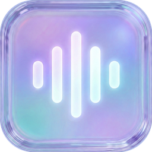
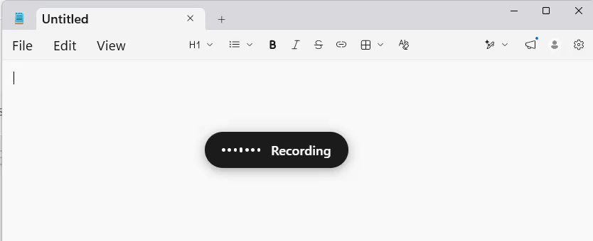
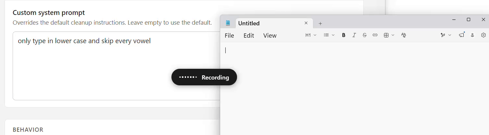

<p align="center">
  
</p>

<h1 align="center">FreeFlow for Windows</h1>

<p align="center">
  The Windows port of <a href="https://freeflow.zachlatta.com/">FreeFlow</a>, a free and open source alternative to <a href="https://wisprflow.ai/">Wispr Flow</a>, <a href="https://superwhisper.com/">Superwhisper</a>, and <a href="https://monologue.to/">Monologue</a>.
</p>

<p align="center">
  <a href="https://github.com/EDRipper/freeflow-windows/releases/latest/download/FreeFlow-Setup.exe"><b>⬇ Download FreeFlow-Setup.exe</b></a><br>
  <sub>Windows 10 and 11 (64-bit)</sub>
</p>

---

<p align="center">
  
</p>

<p align="center">
  <i>A Windows port of <a href="https://github.com/zachlatta/freeflow">zachlatta/freeflow</a>.</i>
</p>

## Overview

FreeFlow is a free dictation app. Hold a key, talk, and what you say is transcribed, cleaned up, and pasted into whatever text field you were in. It gives you fast AI transcription, context-aware cleanup, and voice-driven text editing without a subscription.

## Quick Start

1. Download the installer from above and run it. It is not code-signed yet, so Windows SmartScreen may warn you once: click **More info -> Run anyway**.
2. Get a free Groq API key from [console.groq.com/keys](https://console.groq.com/keys) and paste it into FreeFlow's settings (open settings from the tray icon).
3. Hold **Right Shift** to talk, or tap **Ctrl + Right Shift** to start and stop dictation, and have whatever you say pasted into the current text field.

FreeFlow lives in the system tray. Both shortcuts are customizable in settings.

## Features

- **Custom shortcuts:** Customize both the hold-to-talk and the toggle shortcut. The toggle can extend the hold shortcut, so you can start in hold mode and press the extra keys to latch into toggle mode without stopping the recording.
- **Context-aware cleanup:** FreeFlow reads the active app and window so names, terms, and phrasing are spelled correctly when you dictate into email, terminals, docs, and other apps.
- **Custom vocabulary:** Add names, jargon, and project-specific words that FreeFlow should preserve during cleanup.
- **Dictation history:** Review recent dictations, copy any of them again, and open a per-entry debug view with the raw transcript, the exact prompt sent, and per-stage timings.
- **OpenAI-compatible providers:** Use Groq by default, or point FreeFlow at any OpenAI-compatible endpoint, including a local model, in settings.
- **Automatic updates:** FreeFlow checks for new versions in the background and offers to install them on restart.

## Edit Mode

Edit Mode lets you highlight existing text and transform it with a spoken instruction, like "make this shorter" or "turn this into bullets." Enable it in settings, then use your normal dictation shortcut while text is selected.

<p align="center">
  
</p>

## Privacy

There is no FreeFlow server, so FreeFlow does not store or retain your data on a server. The only information that leaves your computer are the API calls to your configured transcription and LLM provider. Your API key is stored encrypted on your machine (Windows DPAPI), and dictation history is kept locally.

## Using a Local Model

FreeFlow can use any OpenAI-compatible local or self-hosted provider instead of Groq, such as Ollama or LM Studio. In settings, set the base URL and model IDs. If your transcription backend uses a different endpoint from your LLM backend, set the transcription API URL separately. Local models are often slower, so the Advanced settings let you raise the transcription, post-processing, and context timeouts.

## Build from Source

```
npm install
npm run build        # compile main + preload + bundle renderer
npm start            # run locally
npm run dist:win     # produce a Windows installer in release/
```

Releases are built on `windows-latest` via GitHub Actions and attached to tagged releases.

## License

Licensed under the MIT license, same as upstream FreeFlow.

---

<p align="center">
  Thank you to <a href="https://github.com/zachlatta">@zachlatta</a> and the <a href="https://github.com/zachlatta/freeflow">FreeFlow</a> project for the original app that made this port possible.
</p>

